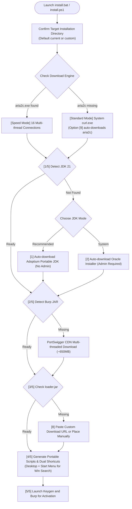

# Burp Suite Pro Bootstrapper & Maintenance Toolkit

A PowerShell-based portable installer, environment automator, and lifecycle maintenance tool for Burp Suite Professional on Windows.

---

## 🏗️ Architecture Overview

The toolkit employs a decoupled 3-tier architecture to completely suppress terminal console popups while maintaining complete portability:

```mermaid
flowchart TD
    User(["User Action\n(Desktop Icon / Win Search)"]) -->|Trigger| Wscript["wscript.exe\n(Native Windows Script Host)"]
    Wscript -->|Silent Run (SW_HIDE: 0)| VBS["Burp-Suite-Pro.vbs\n(Wrapper: Suppress Console Flash)"]
    VBS -->|Dynamic Path Resolution| BAT["Burp.bat\n(Router: Environment & JVM Options)"]

    subgraph BAT_Logic ["Burp.bat Dynamic Logic"]
        CheckJDK{"Local\njdk-21\\bin\\javaw.exe exists?"}
        CheckJDK -->|Yes| UseLocal["Use Local Portable JDK 21"]
        CheckJDK -->|No| UseSystem["Use System Installed JDK 21"]
        FindJAR["Dynamic Matching burpsuite_pro*.jar"]
        SetMem["Tune Memory -Xmx4096m & G1GC"]
        SetOpts["Configure 6 JVM --add-opens Modules"]
    end

    BAT --> BAT_Logic
    UseLocal --> Exec["javaw.exe\n(GUI Subsystem, Zero Console Window)"]
    UseSystem --> Exec
    FindJAR --> Exec
    SetMem --> Exec
    SetOpts --> Exec

    subgraph Runtime ["Active Instances"]
        Loader["-javaagent:loader.jar\n(Virtual License Agent)"]
        BurpApp["burpsuite_pro*.jar\n(Burp Suite Pro GUI)"]
    end

    Exec --> Loader
    Exec --> BurpApp
```

### Component Breakdown:
| Component | Role | Purpose |
| :--- | :--- | :--- |
| **`Burp-Suite-Pro.vbs`** | Stealth Wrapper | Runs `Burp.bat` with `0` (`SW_HIDE`), eliminating the 0.1s black console flash of `cmd.exe`. |
| **`Burp.bat`** | Logic Router | Handles portable vs system JDK routing, dynamic JAR name matching, and G1GC / memory allocations. |
| **`javaw.exe`** | GUI Subsystem | Executes Java without allocating any Windows console or terminal prompt. |

---

## 🔄 Installation & Maintenance Flow



---

## ✨ Features

- **Zero-Console Silent Launch**: Seamlessly coordinates `wscript`, `vbs`, and `javaw.exe` to guarantee zero black terminal windows.
- **Custom Installation Target Directory**: Supports `-InstallPath` CLI parameter or interactive directory prompt/switching.
- **Custom Loader URL Download**: Supports `-LoaderUrl` parameter or interactive prompt to paste a custom download link for `loader.jar`.
- **Portable OpenJDK 21 Option**: 100% portable setup without requiring Windows Administrator rights.
- **Resilient Multi-Threaded Downloads**: Uses `aria2c` (16 connections with breakpoint resume) or `curl` with size validation. Menu option `[9]` auto-installs `aria2c.exe`.
- **Fully Portable Launchers**: `Burp.bat` and `Burp-Suite-Pro.vbs` use dynamic `%~dp0` relative paths.
- **JVM Performance Tuning**: Default `-Xms1024m -Xmx4096m -XX:+UseG1GC` configuration with customizable memory limits.
- **Desktop & Start Menu Shortcuts**: Automatically registers silent background launch shortcuts on Desktop and Windows Start Menu (enabling instant Windows Search for `burp`), without polluting system environment variables.
- **Interactive Maintenance TUI**:
  - Live status dashboard (Target dir, Download engine, JDK, Burp JAR, Loader, Shortcut).
  - One-click setup & repair.
  - One-click PortSwigger JAR update.
  - Memory tuning and temp file cleaning.
  - Target directory switching.

---

## 🚀 Quick Start

1. Place your `loader.jar` in the root folder or target folder (or paste a download URL when prompted).
2. Run installation:
   - **Double-click**: Run `install.bat` and follow the interactive menu.
   - **Command Line with Target Path**:
     ```powershell
     .\install.ps1 -InstallPath "C:\MyAPP\Sec\BurpSuitePro"
     ```
3. Follow the menu prompt `[1]` to initialize the environment and launch the software.
