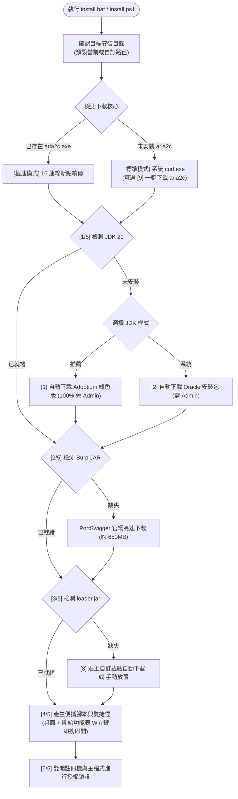

# Burp Suite Pro 自動化安裝與維護工具箱

基於 PowerShell 的 Windows 平台 Burp Suite Professional 綠色安裝、環境配置與生命週期維護工具。

---

## 🏗️ 系統架構圖 (Architecture Overview)

專案採用「三層解耦設計」，消滅黑框控制台並確保環境 100% 便攜獨立：

```mermaid
flowchart TD
    User(["使用者操作\n(桌面圖示 / Win 鍵搜尋)"]) -->|觸發| Wscript["wscript.exe\n(Windows 內建腳本宿主)"]
    Wscript -->|靜默呼叫 (SW_HIDE: 0)| VBS["Burp-Suite-Pro.vbs\n(隱形斗篷: 消除黑框快閃)"]
    VBS -->|動態解析目錄| BAT["Burp.bat\n(大腦: 動態環境路由與參數配置)"]

    subgraph BAT_Logic ["Burp.bat 動態決策邏輯"]
        CheckJDK{"本地是否有\njdk-21\\bin\\javaw.exe?"}
        CheckJDK -->|是| UseLocal["使用本地綠色版 JDK 21"]
        CheckJDK -->|否| UseSystem["使用系統 JDK 21"]
        FindJAR["動態匹配 burpsuite_pro*.jar"]
        SetMem["配置記憶體 -Xmx4096m 與 G1GC"]
        SetOpts["配置 6 組 JVM --add-opens 模組參數"]
    end

    BAT --> BAT_Logic
    UseLocal --> Exec["javaw.exe\n(純 GUI 視窗子系統，零黑框)"]
    UseSystem --> Exec
    FindJAR --> Exec
    SetMem --> Exec
    SetOpts --> Exec

    subgraph Runtime ["核心運行個體"]
        Loader["-javaagent:loader.jar\n(虛擬授權載入器)"]
        BurpApp["burpsuite_pro*.jar\n(Burp Suite Pro 主視窗)"]
    end

    Exec --> Loader
    Exec --> BurpApp
```

### 三層架構職責分工：
| 元件 | 角色定位 | 技術職責 |
| :--- | :--- | :--- |
| **`Burp-Suite-Pro.vbs`** | 隱形斗篷 | 消除 `cmd.exe` 在批次檔啟動時那 0.1 秒的黑框快閃，保持無黑框背景靜默執行。 |
| **`Burp.bat`** | 邏輯大腦 | 負責動態尋找綠色 JDK/系統 JDK、匹配最新 JAR 檔名，並調配 G1GC 與記憶體參數。 |
| **`javaw.exe`** | 視窗執行器 | 採用 Windows GUI 子系統啟動 Java，完全不分配任何 Console 視窗。 |

---

## 🔄 安裝與維護生命週期流程圖 (Lifecycle Workflow)



---

## ✨ 功能特點

- **純 GUI 零黑框啟動**：全面結合 `wscript`、`vbs` 與 `javaw.exe`，徹底杜絕任何控制台命令提示字元黑框快閃。
- **支援自訂安裝目標目錄**：支援 `-InstallPath` 參數或互動式提示切換目錄，可自腳本倉庫一鍵部署到系統任意磁碟/工作路徑。
- **支援自訂 Loader 網址下載**：支援 `-LoaderUrl` 參數、選單 `[8]` 或安裝時缺檔自動提示貼上 URL，自動調用多線程下載 `loader.jar`。
- **支援綠色免安裝 OpenJDK 21**：可選下載解壓至本地 `jdk-21\`，**100% 免系統管理員權限**，隨身碟隨插即用。
- **穩健多線程斷點續傳**：優先調用 `aria2c` 16 線程續傳，具備最低檔案大小門檻校驗，防範防盜鏈與無效重定向；支援選單 `[9]` 一鍵自動安裝綠色版 `aria2c.exe`。
- **全動態相對路徑**：`Burp.bat` 與 `Burp-Suite-Pro.vbs` 使用動態 `%~dp0` 相對路徑，任意搬移不失效。
- **JVM 記憶體與垃圾回收調優**：預設設定 `-Xms1024m -Xmx4096m -XX:+UseG1GC`，杜絕大量封包檢測時的 OOM 崩潰。
- **桌面與開始功能表捷徑同步**：自動在桌面與 Windows 開始功能表建立無黑框背景捷徑（按鍵盤 `Win` 鍵搜尋 `burp` 秒啟動），無需污染系統環境變數即可清楚感知安裝狀態。
- **互動式 TUI 維護選單**：
  - 即時環境狀態儀表板（目標目錄、JDK、Burp JAR、Loader、捷徑、下載核心）。
  - 一鍵全新安裝與環境修復。
  - 一鍵更新 PortSwigger 官方最新 JAR。
  - 自訂記憶體上限與下載暫存檔清理。
  - 隨時切換目標安裝路徑。

---

## 🚀 快速使用

1. 將 `loader.jar` 置於腳本同目錄或目標目錄下（若無可待腳本提示貼上載點自動抓取）。
2. 啟動安裝：
   - **直接雙擊**：執行 `install.bat`，依選單提示進行。
   - **指定目標路徑執行**：
     ```powershell
     .\install.ps1 -InstallPath "C:\MyAPP\Sec\BurpSuitePro"
     ```
3. 依選單提示輸入 `1` 進行一鍵配置並啟動。
