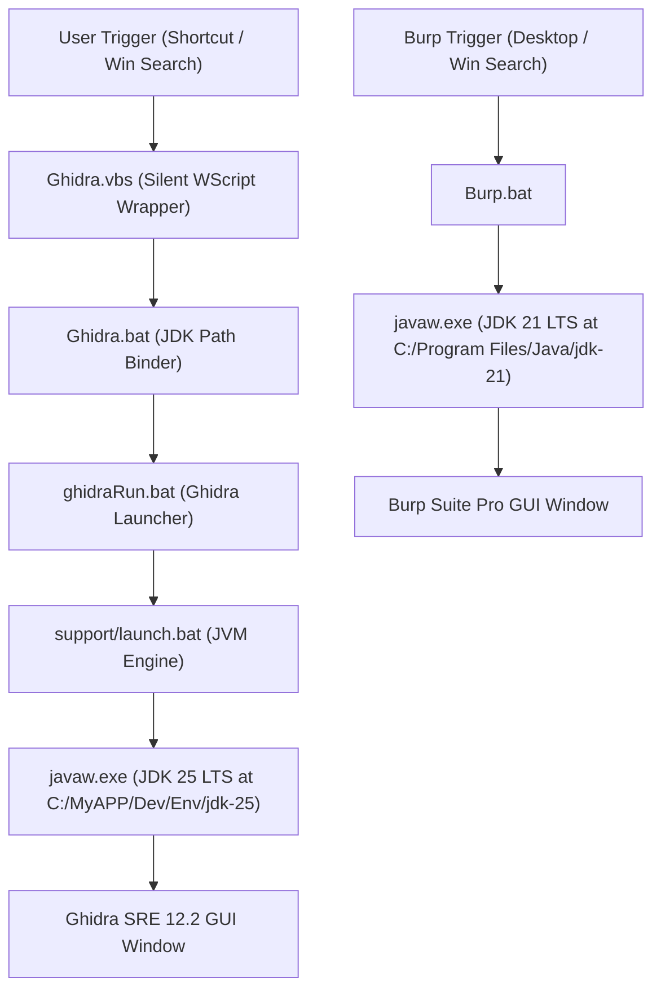
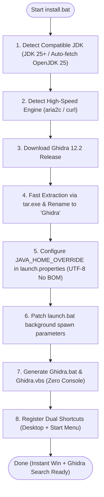

# Ghidra SRE Bootstrapper & Shortcut Manager

Automated installer, environment bootstrapper, silent zero-console launcher generator, and dual shortcut registration toolkit for the **NSA Ghidra Software Reverse Engineering Framework (Ghidra 12.2 + JDK 25 LTS)**.

---

## 1. Architecture & Dual-JDK Isolation



---

## 2. Bootstrapper Lifecycle



---

## 3. Key Features

- **Ghidra 12.2 & JDK 25 LTS Native Support**: Fully compiled for and paired with the latest OpenJDK 25 LTS release.
- **Dual-JDK Safe Coexistence**: Keeps Burp Suite Pro strictly pinned to stable JDK 21, while Ghidra runs on JDK 25.
- **Capitalized Clean Hierarchy**: Ensures standard uppercase naming convention (`C:\MyAPP\Sec\Ghidra`).
- **Silent Zero-Console Launcher**: Wraps execution inside `Ghidra.vbs` and `javaw.exe`, preventing annoying black terminal windows from flashing or remaining open.
- **Dual Shortcut Registration**:
  - **Desktop**: Fast double-click access with high-resolution `ghidra.ico`.
  - **Start Menu (`Programs`)**: Fully indexed by Windows Search. Press `Win`, type `ghidra`, and press `Enter` to launch immediately.
- **Pure ASCII Batch Wrapper**: `install.bat` uses strictly ASCII characters to prevent Windows CP950/CP437 multi-byte parsing errors.

---

## 4. Usage

### Interactive / Quick Run
Double-click `install.bat` or run in terminal:
```cmd
install.bat
```

### CLI Parameters (PowerShell)
```powershell
.\install.ps1 -InstallPath "C:\MyAPP\Sec\Ghidra" -SkipDownload
```

| Parameter | Type | Description | Default |
| :--- | :--- | :--- | :--- |
| `-InstallPath` | String | Target directory for Ghidra installation | `C:\MyAPP\Sec\Ghidra` |
| `-SkipDownload` | Switch | Skip downloading if Ghidra already exists | `False` |
| `-Help` | Switch | Display detailed help | `False` |
