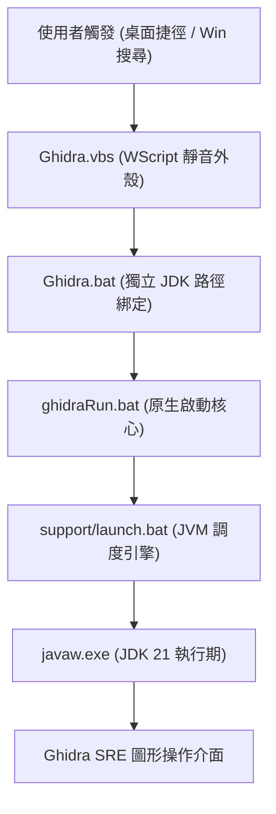
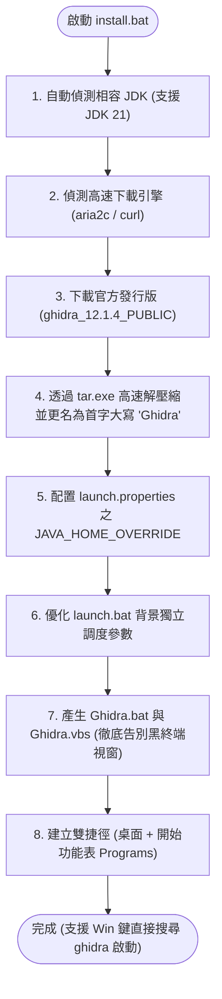

# Ghidra 逆向工程框架自動化安裝與雙捷徑註冊工具

專為 **NSA Ghidra 軟體逆向工程框架** 設計的一鍵自動化發行版安裝、環境綁定、無黑窗靜音啟動器生成與雙捷徑（桌面 + 開始功能表）註冊工具庫。

---

## 1. 架構設計



---

## 2. 安裝與維護生命週期



---

## 3. 核心亮點

- **目錄規範符合標準**：依循使用者規範，根目錄自動採用首字大寫 (`C:\MyAPP\Sec\Ghidra`)。
- **徹底消除命令提示字元黑窗**：透過 `Ghidra.vbs` 與 `javaw.exe` 背景調度，啟動時完全不會彈出或殘留黑色 cmd 命令視窗。
- **雙捷徑無縫整合 Windows 搜尋**：
  - **桌面捷徑**：掛載官方高解析度 `ghidra.ico` 圖示。
  - **開始功能表 (`Programs`) 捷徑**：立即被 Windows Search 索引。日常只需按下鍵盤 `Win` 鍵，輸入 `ghidra` 並按下 `Enter` 即可秒開。
- **JDK 智慧偵測與環境隔離**：自動掃描並優先綁定現有的 JDK 21，無需也不會污染 Windows 全域 `PATH` 與 `JAVA_HOME`。
- **純 ASCII 批次檔保護**：所有 `.bat` 腳本均採用純 ASCII 英文註解，杜絕 Windows CP950/CP437 繁中多位元組編碼造成的批次檔斷行解析崩潰問題。

---

## 4. 使用方式

### 快速一鍵安裝
滑鼠雙擊 `install.bat` 或在終端機中執行：
```cmd
install.bat
```

### PowerShell 參數化執行
```powershell
.\install.ps1 -InstallPath "C:\MyAPP\Sec\Ghidra" -SkipDownload
```

| 參數 | 型別 | 說明 | 預設值 |
| :--- | :--- | :--- | :--- |
| `-InstallPath` | String | Ghidra 目標安裝目錄 | `C:\MyAPP\Sec\Ghidra` |
| `-SkipDownload` | Switch | 若目錄已有 Ghidra 則跳過下載直接註冊捷徑與設定 | `False` |
| `-Help` | Switch | 顯示說明資訊 | `False` |
