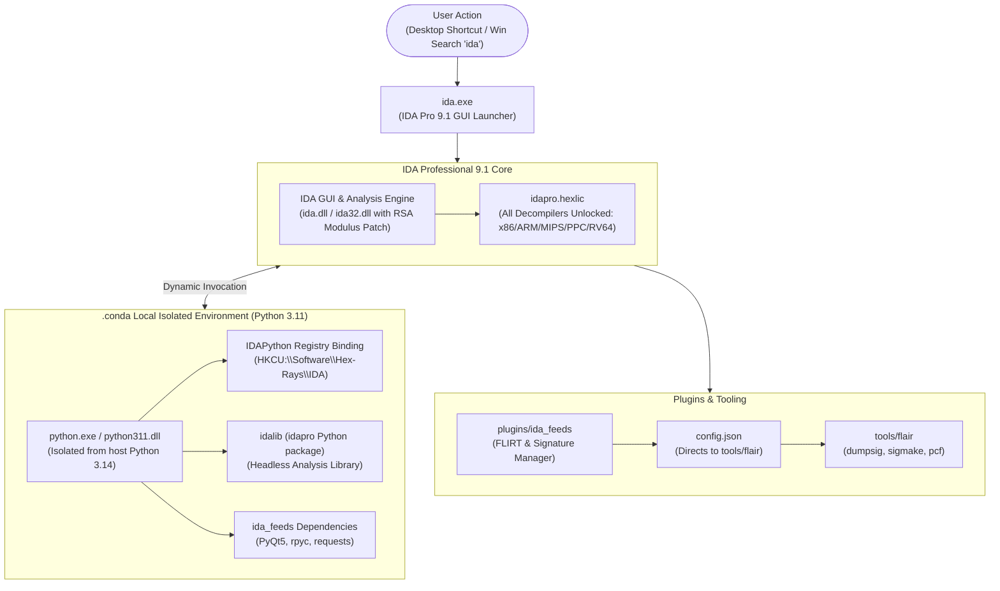
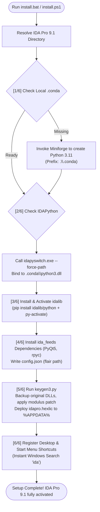

# IDA Pro 9.1 Bootstrapper & Maintenance Toolkit

A PowerShell-based automated setup, isolated environment configuration, and lifecycle maintenance tool for IDA Professional 9.1 on Windows.

---

## 🏗️ Architecture Overview

The toolkit adopts a project-local prefix (`.conda`) standard, fully encapsulating Python 3.11 and dependencies inside the IDA directory:

---

## 🔄 Lifecycle Workflow

---

## ✨ Features

- **Project-Local Prefix (`.conda`)**: Strictly follows the isolated environment standard without system Python 3.14 conflicts.
- **IDAPython Auto-Alignment**: Invokes `idapyswitch.exe` to bind registry keys, fixing `No suitable Python installations were found`.
- **Headless `idalib` Activation**: Builds `idapro` wheel and links dynamic libraries for background batch reverse engineering.
- **`ida_feeds` & `flair` Integration**: Auto-installs PyQt5/rpyc and writes correct `tools/flair` paths to `config.json`.
- **Defensive License & Patch Application**: Safely backups `ida.dll` / `ida32.dll` to `.bak`, unlocks all arch decompilers.
- **Start Menu Instant Search**: Creates shortcuts on Desktop and Windows Start Menu (Win key search `ida`).
- **Interactive TUI Wizard**: Real-time status monitoring, one-click repair, re-activation, and launcher options.

---

## 🚀 Quick Start

1. Place this toolkit in the IDA directory (or pass `-IdaPath`).
2. Double-click `install.bat`.
3. Select `[1]` to run full automatic configuration.
