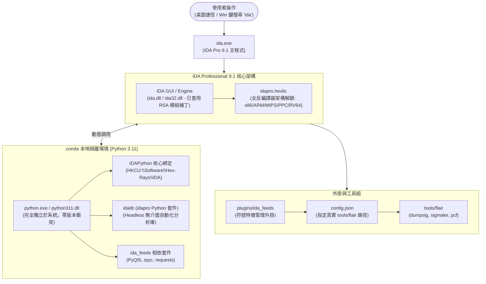
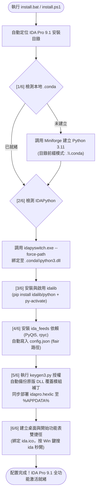

# IDA Pro 9.1 自動化配置與維護工具箱

基於 PowerShell 的 Windows 平台 IDA Professional 9.1 本地環境隔離、IDAPython、idalib、外掛與授權一鍵全自動配置與維護工具。

---

## 🏗️ 系統架構圖 (Architecture Overview)

工具箱採用本地隔離 `.conda` 規範，將 Python 3.11 與所有相依性完全封裝於 IDA 安裝目錄下：

---

## 🔄 一鍵自動化配置生命週期流程 (Lifecycle Flow)

---

## ✨ 功能特點

- **專案本地前綴隔離 (`.conda`)**：遵循 `tool-scripts` 規範，環境建立在 `IDA Professional 9.1\.conda`，徹底避免系統 Python 3.14 衝突，隨插即用。
- **IDAPython 自動對齊**：調用 `idapyswitch.exe` 精確寫入註冊表，徹底解決安裝時 `No suitable Python installations were found` 報錯。
- **Headless `idalib` 啟用**：自動建置 `idapro` wheel 並完成動態庫連線，支援在背景以 Python 批次逆向分析。
- **`ida_feeds` 與 `flair` 整合**：自動安裝 PyQt5/rpyc，自動偵測真實工具路徑並生成 `config.json`。
- **防禦性授權與補丁套用**：自動備份原版 `ida.dll` / `ida32.dll` 為 `.bak`，安全套用公鑰補丁，全開 x86/ARM/MIPS/PPC 等所有架構反編譯器。
- **開始功能表即搜即開**：自動註冊雙捷徑，按鍵盤 `Win` 鍵打 `ida` 秒開，無污染系統全域變數。
- **互動式 TUI 維護選單**：支援即時看板巡檢、一鍵修復、重新激活、重建捷徑。

---

## 🚀 快速使用

1. 將本工具箱放置於 IDA 安裝目錄下（或指定參數執行）。
2. 雙擊執行 **`install.bat`**。
3. 依選單提示輸入 **`1`** 進行一鍵全自動配置！
